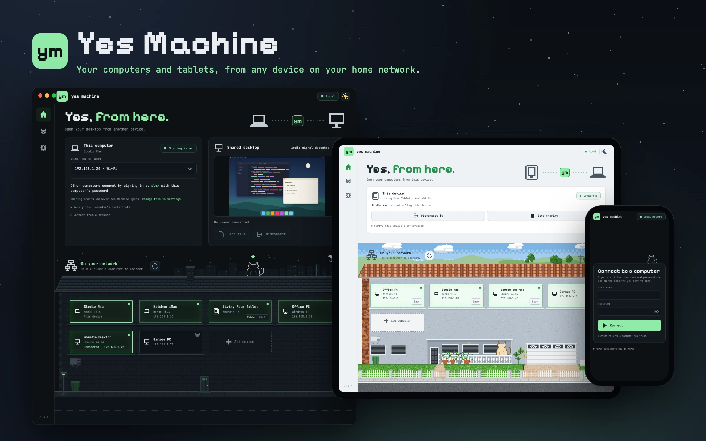
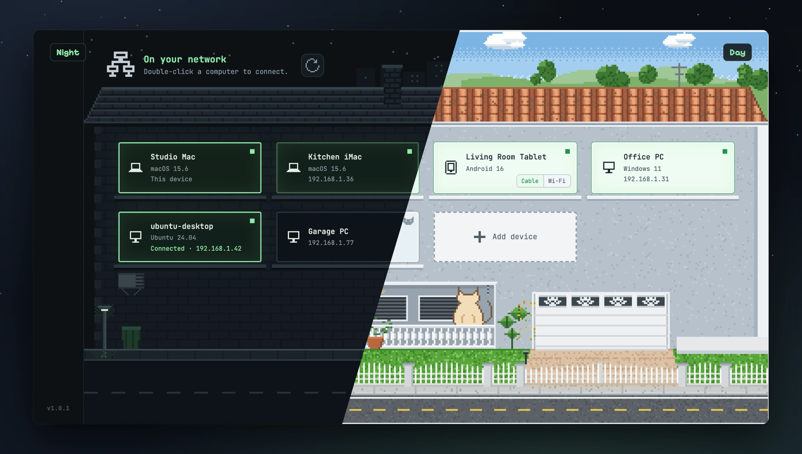
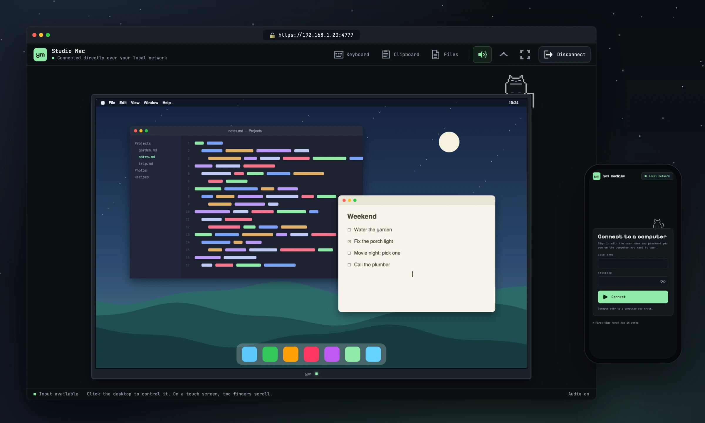
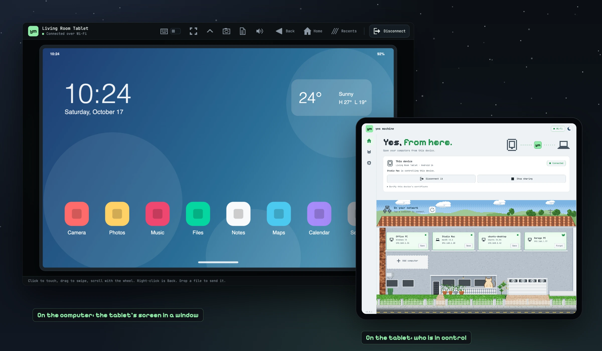
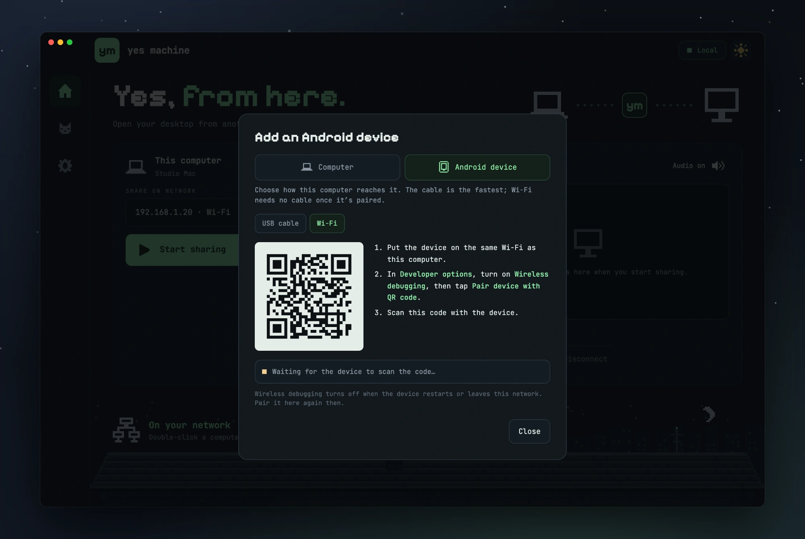
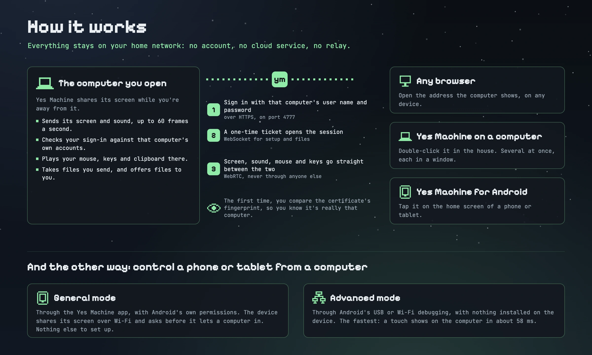

<p align="center">
  
</p>

<p align="center">
  <b>Open your computers and tablets from any device on your home network.</b><br>
  No account, no cloud service, no relay: your devices find each other and connect directly.
</p>

<p align="center">
  <a href="#get-started">Get started</a> ·
  <a href="#a-look-around">A look around</a> ·
  <a href="#control-an-android-device">Android</a> ·
  <a href="#how-it-works">How it works</a> ·
  <a href="docs/ARCHITECTURE.md">The code</a>
</p>

# Yes Machine

An English-language remote desktop app for devices on the same private network. Run the desktop app on a computer and connect to it from another device's browser, from Yes Machine on another computer, or from the Android app. The desktop app can also control an Android phone or tablet, through the Yes Machine app on it or through Android's USB or Wi-Fi debugging connection.

**Version 1.1.0 is an original remote desktop app, not a complete NoMachine replacement.** It is free software under the MIT license and is not affiliated with NoMachine. See [docs/VALIDATION.md](docs/VALIDATION.md) for the test results and the checks still to do.

## What it does

- **See and control another computer:** its main screen over WebRTC at up to 60 frames per second, as large as your window shows it, up to the screen's own size, with keyboard, pointer, click, double-click, drag and scroll. A pointer move shows on screen in about 80 ms on good Wi-Fi.
- **Hear it:** the computer's sound, when its platform and permissions allow capture.
- **Control an Android phone or tablet** from a computer: touch, type, hear it, and pass files and copied text, in [general or advanced mode](#control-an-android-device).
- **Move files** either way, up to **10 GB each**, straight to disk.
- **Share the clipboard:** text copied on one device is ready to paste on the other, both ways.
- **Sign in safely:** with the computer's own account, after comparing its certificate's fingerprint the first time.
- **Find your devices on its own:** computers and Android devices sharing on the network appear by themselves. You can also add any computer by its address.
- **Be ready when you are:** Yes Machine starts in the background when you log in and shares on its own; both can be turned off in Settings. A small icon in the menu bar (the notification area on Windows) shows whether it's sharing, with **Open Yes Machine** and **Quit Yes Machine**; closing the window keeps it running, so other devices can still connect. On GNOME the icon needs the AppIndicator extension, which Ubuntu turns on by default.

## A look around

### Your network, as a house



The desktop app draws the devices it finds as the windows of a house: this computer first, then every computer and Android device on the network, with its system and address. Lit windows are online; a cat badge marks a computer you added by hand. Double-click one to connect, or press **Add device**. The house shows two floors until you ask for the rest.

The sun beside **Local** in the title bar turns the app to day, and the moon back to night. On the home screen Sarigüeya climbs down from the night roof to the porch of her house by day, while daylight crosses the house; elsewhere, or with reduced motion, the mode just changes. By day the garage door and the gates open while the computer shares, and she wags her tail while it's connected to or from another computer. The viewer windows change with it, and a browser follows its own device's light or dark setting. The Android app has the same switch, and colors Android's bars to match. **Know the rooftop cat**, the cat button in the sidebar, tells her story; tap or click her for a heart.

### See and control another computer



The viewer shows the other computer inside a pixel monitor, with a cat napping on top. Click the desktop to type there; on a touch screen, drag to move and use two fingers to scroll. **Keyboard**, **Clipboard** and **Files** in the tool bar open a panel beside the desktop. **Hide bars** lets the desktop fill the window, and **Full screen** the whole screen. On a computer with two or more screens, **Screen** in the tool bar switches which one you see.

The same viewer runs in any browser, in the desktop app's windows (several computers at once, one window each) and in the Android app, which views one computer at a time.

### Control an Android phone or tablet



On the computer, the device's screen opens in a window: click to touch, drag to swipe, scroll with the wheel, and type on the computer's keyboard. Its sound plays on the computer, files and copied text go both ways, and the bar has Back, Home and Recents. On the device, the Yes Machine app says which computer is in control and lets you end it. [How to set it up](#control-an-android-device).

### Add a device



**Add device** adds a computer by its private address, or, switched to **Android device**, a phone or tablet by USB cable or over Wi-Fi: scan the code with Android's **Pair device with QR code**, and Yes Machine pairs with it and connects.

## Get started

### Downloads

Get the file for your system from the [latest release](https://github.com/rOrtiz28/YesMachinePublic/releases/latest), or run Yes Machine from source as described below. The release's `SHA256SUMS` lists each file's checksum.

| System | File | The first time |
| --- | --- | --- |
| macOS, Apple silicon | `…-mac-arm64.dmg` | Open it and drag **Yes Machine** to Applications. The app isn't notarized by Apple, so macOS stops it the first time: open **System Settings → Privacy & Security** and choose **Open Anyway**. |
| macOS, Intel | `…-mac-x64.dmg` | The same. |
| Windows 10 or 11, x64 or ARM | `…-win.exe` | Run it: it installs Yes Machine for your account, adds it to the Start menu and opens it. The installer isn't signed, so SmartScreen may warn about it: choose **More info → Run anyway**. To remove it, use **Settings → Apps**. |
| Ubuntu or Debian | `…-linux-amd64.deb`, or `…-linux-arm64.deb` on ARM | Open it, and App Center installs it; or run `sudo apt install ./` followed by the file's name. Yes Machine then appears among your apps, with Chromium's sandbox and the sound already set up. |
| Other Linux | `…-linux-x64.tar.gz`, or `…-linux-arm64.tar.gz` on ARM | Extract it and run `yes-machine` in the folder. Where sandboxes are restricted, Chromium's sandbox helper must belong to root first: `sudo chown root:root chrome-sandbox && sudo chmod 4755 chrome-sandbox`. Sound needs `pulseaudio-utils`. |
| Android 8 or later | `…-android.apk` | Open it on the device and allow installing apps from that source. |

### Run from source

Use **Node.js 22 or later** with npm. In this project's folder:

```sh
npm ci
npm start
```

On a Debian or Ubuntu Linux computer, install these first; they supply the native input libraries, build headers and the audio utility (package names can vary between distributions):

```sh
sudo apt install libxtst-dev libx11-dev libpng-dev pulseaudio-utils
```

<details>
<summary><b>Tests, packaging and building for a Mac</b></summary>

```sh
npm test            # the automated checks
npm run format      # format the code with Prettier (npm run format:check only checks)
npm run pack        # an unpacked desktop app in dist/
npm run dist        # the distributable for this platform
```

- The tests create temporary HTTPS and WebSocket listeners on `127.0.0.1`, so a restricted environment must permit loopback listeners. They don't inject real keyboard or mouse input.
- Android advanced mode needs its device server, built from `android/stream` with the Android SDK and a JDK. Run `npm run android-stream` once before `npm start`, and again after changing that server. `npm run pack` and `npm run dist` build it on their own, against the oldest installed Android platform from API 30.
- If no compatible RobotJS prebuilt binary is available, a native build may also need a compiler, Python and development packages; see [RobotJS's build requirements](https://github.com/jitsi/robotjs#building). Ubuntu lists `parec` in the [pulseaudio-utils package](https://packages.ubuntu.com/noble/pulseaudio-utils).
- If `npm start` reports that Electron failed to install, its binary wasn't downloaded during `npm ci`: run `node node_modules/electron/install.js`.
- To build the Mac app for Apple Silicon, run `npx electron-builder --dir --mac --arm64`; it creates `dist/mac-arm64/Yes Machine.app`. With only an ad hoc signature, macOS treats every new build as a different app, so approve Screen Recording and Accessibility again after replacing it (**Settings → Setup guides** shows how). To keep those permissions across rebuilds on your Mac, run `sh scripts/create-mac-signing-certificate.sh` once: it creates a self-signed "Yes Machine Local Signing" certificate in your login keychain, and every later build is signed with it. Approve the permissions once more after the first signed build.
- The packaging hook removes only `FinderInfo` and `ResourceFork` metadata from the bundle and gives the main executable its own UUID before signing. Keep the project out of iCloud-synced folders such as Documents: syncing duplicates and offloads files in `node_modules`, and Finder metadata in the output prevents signing.

Validate the build on each operating system and processor you target.

</details>

### Connect your devices

**On the computer you want to open:** start Yes Machine. It shares on its own; if **Settings → Share when Yes Machine opens** is off, select **Start sharing**. Approve the system's screen and input permissions when asked; **Settings → Setup guides** has the steps for each system. If the computer has more than one network, choose the one the other device can reach: the list names each one, such as **Wi-Fi** or **Ethernet**, and puts virtual adapters last. If that network goes away, sharing moves to another one, or starts again when a network comes back.

**From another computer with Yes Machine:** double-click the computer in the house. The first time, Yes Machine shows its certificate's fingerprint: compare it with **Verify this computer's certificate** on that computer, and confirm that it matches. Then sign in with that computer's own user name and password, and a viewer window opens. **Remember on this computer** keeps the password, encrypted with the system's keychain. If a computer isn't listed, use **Add device** with its address.

**From the Android app:** tap the computer, or **Add computer** with its address. Compare the fingerprint the first time, confirm, and sign in as on the desktop; **Remember on this device** encrypts the password with an Android Keystore key.

**From a browser:** open the exact address the computer shows under **Connect from a browser**, such as `https://192.168.1.25:4777`. The computer uses its own self-signed certificate: before signing in, compare its **SHA-256 fingerprint** with **Verify this computer's certificate** on the computer, and accept only that certificate, for that address, in the browser's own exception dialog. Never turn off certificate checks altogether. Then sign in with the computer's user name and password; the eye beside the password shows what you typed. Select the speaker in the tool bar to hear the computer.

<details>
<summary><b>More about connecting</b></summary>

- Only the account running Yes Machine on the computer can sign in. Failed sign-ins are limited to five a minute, and the desktop app sends a password only after the TLS handshake shows the approved certificate.
- A computer that later shows a different certificate asks for the comparison again. **Settings → Trusted certificates** forgets every approval, and each viewer window accepts only the approved certificate. Discovery only hints at an address; it never proves who a device is.
- If the connection drops, the viewer window closes and the main window says which computer disconnected. **Save** keeps a discovered computer in the list, and **Forget** removes it. Double-clicking a computer you're connected to brings its window forward.
- In the Android app, trust applies to that exact address and port, and **Settings** forgets saved computers, sign-ins and trusted certificates. A computer announced at an address outside the device's network, such as a virtual machine behind NAT, is labeled **Another network**; give the virtual machine a bridged adapter to reach it. Leaving the app disconnects the session, except while its document picker or Save dialog is open.
- One viewer at a time: signing in from another device takes over the session, and the previous device says that another device connected. On the computer, **Disconnect viewer** removes the current viewer, and **Stop sharing** ends sharing.

</details>

<details>
<summary><b>Using the viewer: keys, the pointer and the panels</b></summary>

- When a Mac controls Windows or Linux, its shortcuts work as on a Mac: ⌘ acts as Ctrl, ⌘ and ⌥ with the arrows and Delete move and delete by line and word, ⌘-click is Ctrl-click, and ⌘Q, ⌘W, ⌘H and ⌘M stay with the Mac. The Windows or Super key is in **Keyboard**.
- Controlling a Windows computer from a device with a mouse, your own pointer stands in for Windows' cursor: it moves at once and takes Windows' shapes, such as the text cursor and the hand over links. The cursor belongs to whoever moved last: when the mouse at the Windows computer moves, Windows' cursor comes back at once, and yours takes over again after that mouse has been still for two seconds.
- **Keyboard** sends typed text, special keys, held modifiers and common shortcuts, which helps on a tablet. **Hide bars** and **Full screen** both leave a small bar at the top, which fades after a few seconds, with **Show bars** to bring everything back. Leaving full screen goes back to the window as it was.
- On a computer with two or more screens, **Screen** shows where they sit and switches which one you see; the computer's own card has the same choice under **Share screen**, and remembers it.

</details>

## Control an Android device

The desktop app controls an Android phone or tablet in one of two modes, one at a time. With the Yes Machine app on the device, choose the mode in its **Settings → Control from a computer**; **See instructions** there shows each mode's steps.

| | General mode | Advanced mode |
| --- | --- | --- |
| **How** | The Yes Machine app, with Android's own permissions | Android's USB or wireless debugging; nothing installed on the device |
| **Network** | Wi-Fi shared with the computer | USB cable, or Wi-Fi after pairing |
| **Speed** | A touch shows in about 110 ms | About half that: about 58 ms |
| **Typing** | Android 13 and later, any character | Every Android version, in the computer's layout |
| **Sound** | With the permission to record audio | Android 13 and later |
| **Who decides** | The device asks before it lets a computer in | Whoever allowed USB debugging |

While the app is in general mode, the computer doesn't offer advanced mode for it, and a device switched to general mode ends its advanced session within two seconds.

### General mode

1. Allow Yes Machine in **Accessibility**, once: on the app's **This device** card, tap **Allow control**, then turn Yes Machine on (on Samsung devices, under **Installed apps**). It lets the computer touch, type and use Back, Home and Recents; without it, the computer can only watch.
2. Tap **Share this device**. Each time, Android asks to record the screen: choose **Share entire screen**. The first time it also asks to record audio, so the computer can hear what apps play.
3. On the computer, the device appears in the house with its name, Android version and address. Double-click it. The first time, compare the device's certificate fingerprint with the one under **Verify this device's certificate** on its card.
4. The device asks **Allow this computer?**, in the app and as a notification. With **Always allow this computer**, it lets that computer in later without asking; **Settings → Allowed computers** forgets them.

The card then names the computer in control, with **Disconnect it** and **Stop sharing**. One computer is in control at a time; another one is told the device is busy.

### Advanced mode

1. On the device, turn on **Developer options**: in **Settings → About**, tap **Build number** seven times (on Samsung devices, under **Software information**). Then turn on **USB debugging** there.
2. On the computer, install Android's platform tools, which include `adb`: with Android Studio, `brew install --cask android-platform-tools` on a Mac, or `sudo apt install adb` on Ubuntu. Yes Machine looks for `adb` in `ANDROID_HOME`, Android Studio's SDK folder, Homebrew and `/usr/bin`; otherwise set `ADB` to its path. Restart Yes Machine.
3. Connect the device by USB and allow this computer when the device asks **Allow USB debugging?**. It appears in the house with **USB cable**; double-click it.

For Wi-Fi, select **Add device**, then **Android device** and **Wi-Fi**, turn on **Wireless debugging** on the device, tap **Pair device with QR code** and scan the code. A device reached both ways has **Cable | Wi-Fi** on its card. Wireless debugging turns off when the device restarts or leaves the network; pair it again then.

Each time you open it, Yes Machine copies its small stream server to the device (`/data/local/tmp/yes-machine-stream.jar`) and runs it with the debugging connection's permissions; it stops when the window closes. USB debugging lets a computer control the device completely, so allow only computers you trust, and turn it off when you no longer need it.

<details>
<summary><b>In the device's window</b></summary>

- **Touch and keys:** click to touch, drag to swipe and scroll with the wheel. Right-click is Back and a middle click is Home, and the bar has **Back**, **Home** and **Recents**, then **Disconnect**. **Settings → Swap Back and Recents** puts them in Samsung's order. What you type follows the computer's keyboard layout, accents and AltGr included. On a Mac, ⌘ acts as Ctrl, while ⌘Q, ⌘W, ⌘H and ⌘M stay with the Mac. In advanced mode, characters the device's keyboard has no key for, such as ¿, ¡ and emoji, are pasted through the device's clipboard, which then gets back what it held.
- **On-screen keyboard:** while you type from the computer, the device keeps its own keyboard hidden; **On-screen keyboard** in the bar brings it back. In advanced mode Yes Machine connects a stand-in keyboard for this, and the first time Android posts a notice that it set up **Yes Machine keyboard**.
- **Sound:** what the device's apps play reaches the computer as 48 kHz stereo, while the device keeps playing it too. The speaker in the bar mutes it on the computer, which remembers.
- **Files:** **Files** opens a drawer. Drop files anywhere on the window, or choose them there, and they go to the device's **Download** folder, up to 10 GB each. To send a file the other way, share it on the device from any app and choose **Yes Machine**; the computer asks where to save it.
- **Clipboard:** shared as **Settings → Share the clipboard** allows on the computer. What is copied on the device reaches the computer within half a second in advanced mode; in general mode, when you leave the device's window or press Ctrl+C or Ctrl+X in it.
- **Hide bars, full screen and screenshots:** **Hide bars** lets the device's screen fill the window, and **Full screen** (F11, or ⌃⌘F on a Mac) the whole screen; Escape leaves it. **Screenshot** saves a picture in **Pictures › Yes Machine**. If the cable is unplugged or the device stops sharing, the window closes and the main window says so.

</details>

## Files, the clipboard and sound

- **Files:** use **Send a file** on the computer, or **Files** in the viewer, where you can also drop a file on the desktop. A file that reaches the computer opens a Save dialog there; canceling it discards the file. A file from the computer is offered to the viewer, whose **Save** downloads it straight to disk, so even a large one never sits in memory. The receiving disk must keep 256 MB free.
- **Clipboard:** while a device is connected, text copied on one is ready to paste on the other, both ways, up to about **60 KB**. **Settings → Share the clipboard** turns it off or sends it one way only. Text copied in a browser goes to the computer when you come back to the viewer, or as you paste with ⌘V or Ctrl+V; Safari and Firefox only let the page read the clipboard then. The Clipboard panel's **Send** and **Get** buttons move text by hand.
- **Sound:** the speaker button on the computer, or **Settings**, includes or leaves out its sound; the viewer plays it once you select its speaker.

## How it works



The computer you open listens on its own private address only. A viewer signs in over HTTPS with that computer's account, gets a one-time ticket, and opens a session over a WebSocket. The screen, sound, input and clipboard then travel over a direct WebRTC connection between the two devices, with no STUN or TURN server. [docs/ARCHITECTURE.md](docs/ARCHITECTURE.md) describes every part of the code and follows a session from end to end.

<details>
<summary><b>Network details: ports, discovery and certificates</b></summary>

- The computer binds to the chosen private IPv4 address. HTTPS, WebSocket signaling and file transfers use **TCP port 4777**; WebRTC screen, sound and control traffic use direct local ICE candidates on dynamic **UDP ports**. Allow the app on the computer's private-network firewall profile; opening TCP 4777 alone may not be enough. On Windows, mark the network as private (**Settings → Network & internet**, the connection, **Private network**) and allow Yes Machine when Windows asks.
- The desktop app browses for **`_yes-machine._tcp`** over mDNS (**UDP port 5353**), and for **`_yes-machine-device._tcp`**, which Android devices announce while sharing in general mode. It announces its name, address, platform, port, protocol version and certificate fingerprint only while sharing, never account names or passwords. Because network equipment can block multicast, it also checks saved computers directly every few seconds, with a TLS handshake that only reads the certificate's fingerprint.
- A file the computer sends is offered at a one-time HTTPS address on the same port, which only the signed-in viewer can take, from its own address, within ten minutes.
- There is no port forwarding or internet relay. Public and relayed ICE candidates are rejected; local mDNS host candidates are allowed. The server checks the browser's origin and host header, allows at most five sign-in attempts a minute per address and across the computer, and permits one signed-in viewer.
- The certificate and private key are kept in the app's data folder. Each of the four most recently used addresses keeps its own certificate, so a computer that moves between Wi-Fi and Ethernet doesn't make other devices verify it again.
- In general mode, an Android device listens on **TCP port 4778** over TLS, with its private key in the Android Keystore. The computer connects with a certificate of its own, which the device remembers when the person there chooses **Always allow this computer**.

</details>

## Requirements

| Device | Role and requirements |
| --- | --- |
| Mac | The app, to share or to view, or a browser viewer. macOS 13 or later; **macOS 14.2 or later** for Yes Machine's system sound. |
| Windows computer | The app or a browser viewer. Windows 10 or later. |
| Linux computer | The app on **Wayland** or **X11**, or a browser viewer. On Wayland, the desktop asks which screen to share each time sharing starts and, once, whether to allow remote control and the clipboard; this needs xdg-desktop-portal with RemoteDesktop, as on GNOME and KDE, and `python3` with its GObject bindings. On X11, input needs libXtst and libpng. Sound needs `parec` and PulseAudio or PipeWire-Pulse. |
| Android phone or tablet | A browser viewer or the Android app: Android 8.0 or later with a current Android System WebView. To be controlled, general mode types on Android 13 and later, and advanced mode is built for Android 10 and later; both were tested on Android 16. Viewing an Android device from a browser or from another Android device isn't supported. |

Both devices must reach each other on the private network, over Wi-Fi or Ethernet in any mix. Guest Wi-Fi isolation, separate VLANs or a firewall can block direct connections even on the same Wi-Fi name. These are the targets, not proof that each platform was tested; Electron publishes its [platform requirements](https://github.com/electron/electron#platform-support), and the native input library its [build requirements](https://github.com/jitsi/robotjs#building).

<details>
<summary><b>Permissions and sound</b></summary>

- On macOS, allow **Screen & System Audio Recording**, **Accessibility** and **Local Network** for Yes Machine when asked. An audio-only permission doesn't authorize screen capture, and setting names vary between macOS versions; relaunch the app if macOS asks you to. Prefer the packaged app for testing sound: Electron's audio capture needs the `NSAudioCaptureUsageDescription` that the packaged app declares, and a stream can exist but carry silence when capture isn't authorized. See Electron's [macOS audio notes](https://www.electronjs.org/docs/latest/api/desktop-capturer#macos-versions-142-or-higher).
- On Linux, the app records the default output's monitor with `parec`. If no sound arrives, check that `pulseaudio-utils` is installed, PulseAudio or PipeWire-Pulse is running, and the output you use is the default.

</details>

## Troubleshooting

**Signing in to Windows fails.** With a Microsoft account, sign in with that account's password; a Windows Hello PIN can't be checked by other apps. Turn off **Settings → Accounts → Sign-in options → For improved security, only allow Windows Hello sign-in for Microsoft accounts on this device**, because while it's on Windows refuses the password. Windows checks the password with Microsoft, so an old one fails even when it still opens other things; on the test computer, changing the account's password fixed it.

**A browser on a Mac says ERR_ADDRESS_UNREACHABLE.** Allow the browser in **System Settings → Privacy & Security → Local Network**, then quit it with **⌘Q** and open it again. macOS blocks apps without that permission from reaching other devices on the network.

**A browser says ERR_EMPTY_RESPONSE.** Check that the address starts with **`https://`** and includes **`:4777`**, for example `https://192.168.1.25:4777/`, with the computer's current address. Entering only the address and port can choose plain HTTP, which Yes Machine doesn't accept.

## Current limits

- One screen at a time; with several, choose which on the computer's card or in the viewer's Screen menu (on Wayland, in the desktop's own dialog). The picture follows the viewer's window, up to 3840×2400; a larger screen is scaled down to that. Viewers from before 1.1, such as the Android app 1.0.2, get it at up to 1920×1200.
- It uses a desktop where someone is logged in. It doesn't get past Windows UAC, a locked screen or a login screen, and there are no unattended or headless sessions. On Wayland, someone at the computer chooses the screen each time sharing starts.
- The clipboard carries plain text only. No shared folders, printer forwarding or USB forwarding.
- Double-clicks work, but how they behave across real applications and devices still needs checking. Double-clicks with keys held down aren't supported.
- A silent sound track isn't proof that sound reached the other device: check the signal on the computer and the sound on the viewer.
- Typing text directly refuses non-ASCII text on Linux and characters such as emoji on Windows, because of the native input library; the clipboard carries them instead. Browser and system shortcuts may be caught locally, and international layouts need more testing on real devices.
- Android: general mode takes about twice as long as advanced mode to show a touch, needs Android's consent to record the screen each time sharing starts, and types only on Android 13 and later. Both modes take one finger at a time (no pinch). Android 8 and 9 keep files from the computer in Yes Machine's own Download folder. Sharing a file from the device needs a computer controlling it. What advanced mode pastes for you, such as ¿, ¡ and emoji, shows up in Samsung Keyboard's clipboard history. Android treats advanced mode's stand-in keyboard like a real one, so an app that restarts when a keyboard is plugged in also restarts when the window opens or closes, or when **On-screen keyboard** changes.
- Mac builds are signed only locally, without Apple notarization, and Windows builds aren't signed. Yes Machine has run on an Apple Silicon Mac, and on Ubuntu 24.04 and Windows 11 on ARM in virtual machines; Windows PCs, Intel Macs and x64 Linux haven't been tested on real computers. There is no automatic update.

## Source layout

The code is in four parts: the desktop app, the browser viewer, the Android app and advanced mode's stream server. [docs/ARCHITECTURE.md](docs/ARCHITECTURE.md) describes every folder and file.

| Path | Purpose |
| --- | --- |
| `src/main/` | The desktop app's main process. `main.cjs` starts the app. `sharing/` is the HTTPS and WebSocket server, the account check (PAM on Linux, Open Directory on macOS, LogonUser on Windows) and the choice of screen. `control/` plays the viewer's keyboard and mouse, natively or through the Wayland portal, and shares the clipboard. `network/` finds computers, names networks and keeps approved certificates. `viewing/` opens other computers in windows. `android/` controls Android devices in advanced and general mode. `system/` starts Yes Machine at login and keeps private settings files |
| `src/preload/` | The only bridges between the sandboxed windows and the main process |
| `src/windows/host/` | The main window: the network list, sharing this computer, Settings, and the WebRTC connection to the viewer |
| `src/windows/android/` | The window for an Android device: hardware-decoded video, touch, wheel and keyboard, files and the clipboard |
| `src/windows/shared/` | Raw sound playback (`pcm-worklet.js`): a Linux computer's system sound into its shared stream, and an Android device's sound in its window. The picture's size for each viewer (`picture-size.js`) |
| `public/` | The browser viewer (`client.html`, with its scripts in `client/` and `style.css`), and the pixel art, key rules, theme, setup guides and fonts that the desktop and Android apps share |
| `android/app/` | The Android app: viewing computers, general mode's screen sharing and control, files and the clipboard with a controlling computer, and Share to Yes Machine. See [android/README.md](android/README.md) |
| `android/stream/` | The device side of advanced mode: screen mirror, hardware H.264 encoder, input injection, sound, files and the clipboard, run over adb |
| `test/` | Automated tests, in folders that follow `src/main/`, plus checks of the pages' source and the build scripts |
| `scripts/` | Starting from source (`start.cjs`), rendering the icons, building the stream server, Mac packaging and local signing, and publishing a version to the public repository (`publish-public.cjs`) |
| `assets/` | Desktop icons of the pixel `ym` logo, rendered from the Android launcher vector |
| `tools/` | Test-only latency and speed measurements; not packaged |
| `docs/` | The architecture, the validation record (`VALIDATION.md`), the README's images, and standalone design previews (`design/`, not packaged) |

Automated tests cover authorization gates, malformed input, modifier cleanup, certificate persistence, browser origin checks, sign-in, private ICE restrictions, exact file bytes, the Android stream protocol and general mode's handshake. They don't replace tests of a real desktop, sound on another device, Android touch, or a second physical device.

## License

Yes Machine is available under the [MIT license](LICENSE). The software it's built on keeps its own licenses, all of which allow this. [THIRD_PARTY_NOTICES.md](THIRD_PARTY_NOTICES.md) lists each one, and both apps include it.

## Acknowledgments

Yes Machine was built in collaboration with [Claude](https://www.anthropic.com/claude), an AI model by Anthropic.
